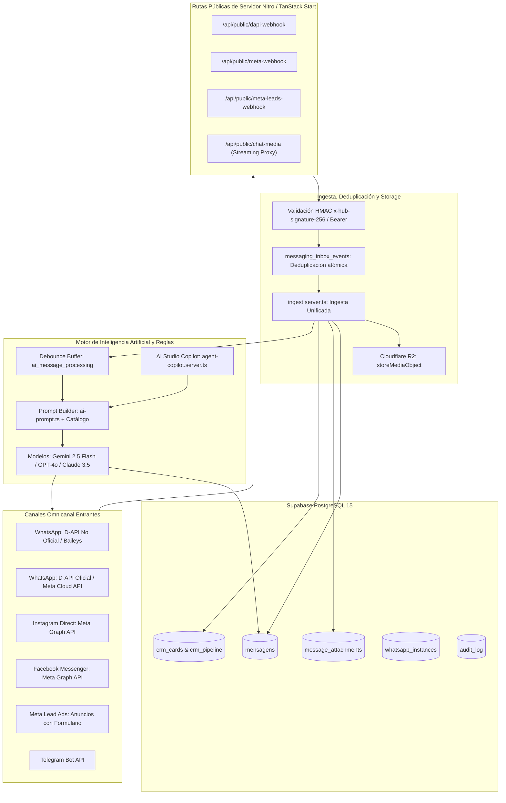

# 📋 Dossier Técnico y Arquitectura Integral de Capiconversa CRM (v1.2.06)

> **Nota para el Agente Analizador / Desarrollador:**
> Este documento ha sido diseñado como la **fuente única de verdad (Single Source of Truth)** de **Capiconversa CRM**. Describe la arquitectura técnica completa, flujos omnicanales, contratos de bases de datos en PostgreSQL, funciones de servidor, variables de entorno, APIs de terceros (D-API WhatsApp Oficial/No Oficial, Meta Graph API v25.0, Instagram Direct, Messenger, Lead Ads, Cloudflare R2, Backblaze B2) y la lógica en tiempo real. 
> 
> En una exportación estándar de código (ZIP) solo se observa el código estático de frontend y rutas Nitro/TanStack Start. Este dossier detalla **todo lo que ocurre detrás de escena** para que cualquier nuevo agente o ingeniero pueda auditar, extender, desplegar o depurar el sistema de inmediato.

---

## 1. Ficha Técnica del Proyecto y Estado Actual

- **Nombre del Producto:** Capiconversa CRM (Capiversa SaaS)
- **Versión Activa:** `v1.2.06`
- **Repositorio Git:** `https://github.com/Edoga0703/blank-canvas.git` (Rama principal: `main`)
- **Hosting de Producción Lovable:** `https://capiconversa.lovable.app` (ID de Proyecto: `6482688e-8e4c-4f18-a0eb-1577103f5563`)
- **Backend As A Service:** Supabase PostgreSQL 15 con Row Level Security (RLS) y Realtime WebSockets
- **Runtime Web / SSR:** TanStack Start (React 19) sobre Vinxi + Nitro Server (Cloudflare Pages / Workers / Node.js)
- **Almacenamiento Multimedia:** Cloudflare R2 (S3 API) + Backblaze B2 + Supabase Storage (Bucket `chat-media`)
- **Empresa de Prueba Activa:**
  - `company_id`: `ef25148b-656e-47c6-8e5c-4c28d99f2b3a`
  - Teléfono Conectado (Instancia): `584129994185` (Nombre de Instancia: `dapi_ef25148b_028d`)
  - Teléfono de Pruebas: `584249174586`

---

## 2. Índice Exhaustivo de Documentación Oficial y Enlaces de Referencia

A continuación se listan las fuentes oficiales que rigen los contratos de integración utilizados por el CRM:

### A. WhatsApp & D-API (Canales Oficial y No Oficial)
- **Guía e Introducción Oficial D-API:** [https://docs.d-api.cloud/whatsapp/introducao](https://docs.d-api.cloud/whatsapp/introducao)
- **API Oficial de WhatsApp (Cloud API WABA):** [https://d-api.cloud/api-oficial-de-whatsapp](https://d-api.cloud/api-oficial-de-whatsapp)
- **API No Oficial de WhatsApp (Baileys / Sesiones QR):** [https://d-api.cloud/api-nao-oficial-de-whatsapp](https://d-api.cloud/api-nao-oficial-de-whatsapp)
- **Repositorio Oficial de Ejemplo SaaS:** [https://github.com/d-api/exemplo-api-oficial-saas](https://github.com/d-api/exemplo-api-oficial-saas)
- **D-API SDK Reference (Endpoints Núcleo):**
  - Envío de Texto: `POST https://api.d-api.cloud/api/v1/messages/send/text`
  - Envío de Media: `POST https://api.d-api.cloud/api/v1/messages/send/media`
  - Envío de Audio PTT Opus: `POST https://api.d-api.cloud/api/v1/messages/send/audio-base64` o `send/media`
  - Envío de Documentos: `POST https://api.d-api.cloud/api/v1/messages/send/document`
  - Envío de Contacto vCard: `POST https://api.d-api.cloud/api/v1/messages/send/contact`
  - Envío de Reacciones: `POST https://api.d-api.cloud/api/v1/messages/send/reaction`
  - Presencia / Typing: `POST https://api.d-api.cloud/api/v1/chats/presence` (`presence: "typing"`)
  - Edición de Mensajes (No Oficial): `PUT https://api.d-api.cloud/api/v1/messages/:id` (`{ text: "nuevo texto" }`)
  - Eliminación para Todos (No Oficial): `DELETE https://api.d-api.cloud/api/v1/chats/messages/:id`
  - Configuración de Webhook: `POST https://api.d-api.cloud/sessions/:id/webhook-config` (`type: "single"`)

### B. Meta Platform (Graph API v21.0 - v25.0)
- **WhatsApp Business Platform (Cloud API):** [https://developers.facebook.com/docs/whatsapp/cloud-api](https://developers.facebook.com/docs/whatsapp/cloud-api)
- **Webhooks de WhatsApp Cloud API:** [https://developers.facebook.com/docs/whatsapp/cloud-api/webhooks](https://developers.facebook.com/docs/whatsapp/cloud-api/webhooks)
- **Plantillas HSM (Message Templates):** [https://developers.facebook.com/docs/whatsapp/business-management-api/message-templates](https://developers.facebook.com/docs/whatsapp/business-management-api/message-templates)
- **Embedded Signup (Onboarding de WABA / Co-existence):** [https://developers.facebook.com/docs/whatsapp/embedded-signup](https://developers.facebook.com/docs/whatsapp/embedded-signup)
- **Instagram Direct Messaging API:** [https://developers.facebook.com/docs/messenger-platform/instagram](https://developers.facebook.com/docs/messenger-platform/instagram)
- **Facebook Messenger Platform:** [https://developers.facebook.com/docs/messenger-platform](https://developers.facebook.com/docs/messenger-platform)
- **Meta Webhooks Reference & Subscriptions:** [https://developers.facebook.com/docs/graph-api/webhooks/reference/page](https://developers.facebook.com/docs/graph-api/webhooks/reference/page)
- **Meta Lead Ads (Clientes Potenciales):** [https://developers.facebook.com/docs/marketing-api/guides/lead-ads](https://developers.facebook.com/docs/marketing-api/guides/lead-ads)
- **Meta Business Login / OAuth 2.0:** [https://developers.facebook.com/docs/facebook-login/guides/advanced/manual-flow](https://developers.facebook.com/docs/facebook-login/guides/advanced/manual-flow)

### C. Almacenamiento S3 y Supabase
- **Cloudflare R2 S3 API:** [https://developers.cloudflare.com/r2/api/s3/api/](https://developers.cloudflare.com/r2/api/s3/api/)
- **Backblaze B2 S3-Compatible API:** [https://www.backblazeb2.com/docs/cloud-storage-s3-compatible-api](https://www.backblaze.com/docs/cloud-storage-s3-compatible-api)
- **Supabase PostgreSQL & RLS:** [https://supabase.com/docs/guides/database/postgres/row-level-security](https://supabase.com/docs/guides/database/postgres/row-level-security)
- **Supabase Realtime:** [https://supabase.com/docs/guides/realtime](https://supabase.com/docs/guides/realtime)
- **TanStack Start Framework:** [https://tanstack.com/start/latest](https://tanstack.com/start/latest)

---

## 3. Topología General y Diagrama de Flujo Omnicanal

Capiconversa opera bajo una arquitectura de microservicios lógicos embebidos en un monorepo TypeScript:



---

## 4. Arquitectura de WhatsApp (Canal Dual Oficial vs No Oficial)

Capiconversa CRM implementa una arquitectura de **doble proveedor simultáneo** (*Dual Stack*), permitiendo coexistencia o conmutación inteligente entre la API No Oficial (`dapi`) y la API Oficial (`dapi_official`).

### Tabla Comparativa de Capacidades por Canal:

| Característica / Capacidad | Canal No Oficial (`dapi` - Baileys) | Canal Oficial (`dapi_official` - Meta Cloud API) | Manejo en el CRM |
|---|---|---|---|
| **Conexión** | Código QR o Código de Emparejamiento (Paircode de 8 dígitos) | Meta Embedded Signup (WABA + Phone Number ID) | `nova-conexao-dialog.tsx` |
| **Envío de Texto** | Ilimitado, directo al JID (`numero@s.whatsapp.net`) | Ventana de 24 horas para texto libre; HSM fuera de ventana | `wa-dispatch.server.ts` |
| **Plantillas HSM** | No requeridas (mensajes directos) | Obligatorias fuera de la ventana de 24 h (categorías Marketing, Utility, Auth) | `hsm-templates.functions.ts` |
| **Edición de Mensajes** | Soportada (`PUT /api/v1/messages/:id`) en <15 min | **No soportada** por WhatsApp Cloud API de Meta | Botón "Editar" visible solo si `hasUnofficialInstance` |
| **Borrado para Todos** | Soportado (`DELETE /api/v1/chats/messages/:id`) | **No soportado** por WhatsApp Cloud API de Meta | Botón "Apagar para todos" activo solo en canal no oficial |
| **Cita / Respuesta (Reply)** | `contextInfo: { stanzaId, participant, quotedMessage }` | `context: { message_id: "<wamid>" }` | `reply_to_id` en `mensagens` + previsualización nativa |
| **Notas de Voz PTT** | Formato OGG Opus con cabecera `audio/ogg; codecs=opus` (`is_ptt: true`) | Subida mediante Media Endpoint o URL con `mimetype: "audio/ogg"` | `whatsapp-audio.tsx` con streaming Range |
| **Reacciones** | `POST /messages/send/reaction` con emoji | `POST /messages/send/reaction` con emoji | Mapeo visual en burbuja (`Bubble`) |
| **Documentos (PDF)** | Base64 o URL directa con `fileName` | URL directa con `fileName` | `ChatMedia` con descarga Blob y `Content-Disposition` |
| **Stickers** | Formato WebP con canal alfa | Formato WebP | Renderizado limpio sin fondo en el chat |
| **Presencia / Typing** | `POST /chats/presence` (`presence: "typing"`) | No aplicable | Disparado antes de que la IA responda |
| **Grupos WhatsApp** | Soportado (`jid` termina en `@g.us`) | Requiere Cloud API Groups Beta | Filtro en `conversas.tsx` |

### Resolución de la Ventana de 24 Horas (`meta-response-window.server.ts`)
Cuando la empresa tiene ambos canales activos (`dapi_official` y `dapi`):
1. El CRM evalúa la última interacción del cliente mediante `getMetaResponseWindow`.
2. Si la ventana de 24 horas de Meta está **abierta**, el mensaje saliente se despacha a través de la **API Oficial** para aprovechar su alta entregabilidad y menor riesgo de bloqueo.
3. Si la ventana de 24 horas está **cerrada** y el usuario envía texto libre (sin plantilla HSM):
   - El sistema conmuta automáticamente (*smart fallback*) a la instancia **No Oficial (`dapi`)** si está conectada, evitando que el mensaje falle con el código de error 131047 de Meta.
   - Si solo existe el canal oficial, el CRM solicita al asesor seleccionar una plantilla HSM aprobada.

---

## 5. Arquitectura Detallada de la Plataforma Meta (Instagram, Messenger y Leads)

### A. Instagram Direct Messaging
- **Protocolo:** Meta Graph API `v25.0` (`https://graph.facebook.com/v25.0` y `https://graph.instagram.com/v25.0`).
- **Endpoint Webhook:** `src/routes/api/public/meta-webhook.ts`.
- **Verificación:**
  - `GET /api/public/meta-webhook?hub.mode=subscribe&hub.challenge=...&hub.verify_token=...`
  - Responde con `hub.challenge` plano cuando el token coincide con `META_WEBHOOK_VERIFY_TOKEN`.
- **Firma:** `x-hub-signature-256` calculada con HMAC-SHA256 usando `META_APP_SECRET`.
- **Identificadores:**
  - `IGSID` (Instagram Scoped ID): Identificador único del cliente para esa cuenta de Instagram Business.
  - `Page ID` / `Instagram Business Account ID`.
- **Despacho Outbound:**
  ```http
  POST https://graph.facebook.com/v25.0/me/messages
  Authorization: Bearer <PAGE_ACCESS_TOKEN>
  Content-Type: application/json

  {
    "recipient": { "id": "<IGSID>" },
    "message": { "text": "Hola, ¿en qué podemos ayudarte?" }
  }
  ```
- **Prevención de Auto-Pausa de IA en Ecos (`is_echo: true`):**
  - Cuando un asesor humano o la propia IA envía un mensaje desde Instagram, Meta dispara un webhook con `entry[].messaging[].message.is_echo = true`.
  - El webhook concilia el `message_id` contra `mensagens`. Si fue generado por `autor: "ia"`, lo marca como eco y **no pausa** el agente de IA. Si fue enviado manualmente desde la app nativa de Instagram por un asesor, se activa la pausa humana (`contact_pause`) por 24 horas.

### B. Facebook Messenger
- **Estructura:** Idéntica a Instagram Direct pero con identificador `PSID` (Page Scoped ID) y `object === "page"`.
- **Eventos Adicionales Soportados:**
  - `messaging_postbacks`: Clics en botones de menús persistentes.
  - `quick_replies`: Respuestas rápidas de botones.
  - `message_reactions`: Reacciones de Messenger conciliadas en el CRM.

### C. Meta Lead Ads (Ingesta de Clientes Potenciales de Campañas)
- **Endpoint Webhook:** `src/routes/api/public/meta-leads-webhook.ts`.
- **Flujo de Ejecución:**
  1. Meta envía un evento de cambio (`field: "leadgen"`) con `leadgen_id`, `page_id` y `form_id`.
  2. El webhook responde `EVENT_RECEIVED` inmediatamente (status 200) para cumplir el timeout de 5 segundos de Meta.
  3. En segundo plano (`processLead`):
     - Obtiene el Page Access Token asociado al `page_id` en `whatsapp_instances`.
     - Invoca la Graph API: `GET https://graph.facebook.com/v25.0/${leadId}`.
     - Extrae los pares clave-valor de `field_data` (`full_name`, `phone_number`, `email`, preguntas personalizadas).
     - Normaliza el número a formato internacional E.164.
     - Crea o actualiza el registro en `contatos` y genera una tarjeta en `crm_cards` dentro de la etapa inicial del pipeline.
     - Si la empresa tiene configurada una automatización de bienvenida, dispara el primer mensaje automático por WhatsApp.

### D. Meta OAuth 2.0 y Facebook Login for Business
- **Archivos:** `src/lib/meta-oauth.server.ts` y `src/routes/api/public/meta-oauth.callback.ts`.
- **Mecanismo:**
  1. El usuario abre el diálogo de conexión en `/app/conexao`.
  2. Inicia sesión con su cuenta de Facebook / Meta Business.
  3. Meta redirige al callback con un `code` temporal.
  4. El servidor intercambia el `code` por un `User Access Token` de corta duración.
  5. Se intercambia por un `Long-Lived User Access Token` válido por 60 días:
     `GET /oauth/access_token?grant_type=fb_exchange_token&client_id=...&client_secret=...&fb_exchange_token=...`
  6. Se consultan las páginas asociadas:
     `GET /me/accounts?fields=id,name,access_token,instagram_business_account{id,username,name}`
  7. Se suscribe la página a los webhooks del CRM:
     `POST /{page_id}/subscribed_apps?subscribed_fields=messages,messaging_postbacks,messaging_optins,message_deliveries,message_reads,message_reactions,feed,leadgen`
  8. Se persiste el `Page Access Token` en `whatsapp_instances` para cada canal (`meta_messenger` y `meta_instagram`).

---

## 6. Capa de Almacenamiento Multimedia y Streaming Proxy

### El Problema de CORS en Backblaze B2 y Audio HTML5
En versiones previas, D-API almacenaba los audios en Backblaze B2 (`s3.us-east-005.backblazeb2.com`). Debido a que dicho bucket no envía cabeceras `Access-Control-Allow-Origin: *`, los navegadores modernos bloqueaban las peticiones de `<audio src="...">`, impidiendo la reproducción e imposibilitando la lectura de rangos (`Range: bytes=0-`).

### La Solución Definitiva (v1.2.05):
Se centralizó la entrega multimedia a través del endpoint servidor [chat-media.ts](file:///C:/Users/User/.gemini/antigravity/scratch/blank-canvas/src/routes/api/public/chat-media.ts):
1. **Seguridad Multi-Tenant (E-02 Blindado):** Requiere un token HMAC firmado (`?id=UUID&sig=...&exp=...`) con expiración corta o cabecera `Authorization: Bearer`.
2. **Streaming por Rangos (Range Requests):** Si el navegador solicita un fragmento (`Range: bytes=X-Y`), el proxy reenvía la cabecera al origen y responde con `206 Partial Content`, `Accept-Ranges: bytes` y el `Content-Range` respectivo.
3. **Cabeceras de Compatibilidad:** Inyecta `Content-Type: audio/ogg; codecs=opus` y `Access-Control-Allow-Origin: *`.
4. **Descarga Forzada de PDFs / Documentos:**
   - Si la URL incluye `&download=1`, el endpoint responde con `Content-Disposition: attachment; filename="Reporte_Prueba_Capiconversa.pdf"`.
   - En el frontend ([chat-media.tsx](file:///C:/Users/User/.gemini/antigravity/scratch/blank-canvas/src/components/chat/chat-media.tsx)), los archivos codificados en data URI (`data:application/pdf;base64,...`) son transformados en el cliente a un `Blob` de JavaScript y descargados mediante `URL.createObjectURL(blob)`, evitando el bloqueo de navegación en Google Chrome y navegadores móviles.

---

## 7. Base de Datos Supabase (Esquema PostgreSQL + RLS + Tipos)

El CRM opera sobre más de 130 tablas en PostgreSQL aisladas por `company_id`. A continuación se detallan las tablas nucleares del motor conversacional:

### A. Tabla `mensagens` (Núcleo de Mensajería)
```sql
CREATE TABLE public.mensagens (
    id uuid DEFAULT gen_random_uuid() PRIMARY KEY,
    company_id uuid NOT NULL REFERENCES public.company(id) ON DELETE CASCADE,
    instance_id uuid REFERENCES public.whatsapp_instances(id),
    numero text NOT NULL,                    -- Teléfono normalizado E.164 o JID
    contato_nome text,                       -- Nombre del remitente
    direcao text NOT NULL CHECK (direcao IN ('entrada', 'saida')),
    autor text NOT NULL CHECK (autor IN ('ia', 'humano', 'contato', 'automacao')),
    texto text NOT NULL,                     -- Contenido de texto
    texto_original text,
    created_at timestamptz DEFAULT now() NOT NULL,
    user_id uuid REFERENCES auth.users(id),  -- Asesor humano asignado (si aplica)
    midia_url text,                          -- URL pública, proxied o data URI
    midia_tipo text,                         -- 'image', 'video', 'audio', 'document', 'sticker'
    midia_mime text,                         -- 'audio/ogg; codecs=opus', 'application/pdf', etc.
    midia_nome text,                         -- Nombre del archivo adjunto
    reacao text,                             -- Emoji de reacción activa
    editado_em timestamptz,                  -- Fecha de última edición (si fue editado)
    deletado_em timestamptz,                 -- Fecha de revocación ("Apagado para todos")
    whatsapp_message_id text,                -- ID externo asignado por WhatsApp / Meta (wamid)
    reply_to_id uuid REFERENCES public.mensagens(id), -- LLAVE FORÁNEA al mensaje citado
    status_envio text DEFAULT 'enviado',     -- 'pendente', 'enviado', 'entregue', 'lido', 'falha'
    provider text,                           -- 'dapi', 'dapi_official', 'meta_instagram', 'telegram'
    raw_payload jsonb                        -- Payload original del webhook
);

CREATE INDEX idx_mensagens_company_numero ON public.mensagens(company_id, numero, created_at DESC);
CREATE INDEX idx_mensagens_wamid ON public.mensagens(company_id, whatsapp_message_id);
```

### B. Tabla `whatsapp_instances` (Canales e Integraciones Conectadas)
```sql
CREATE TABLE public.whatsapp_instances (
    id uuid DEFAULT gen_random_uuid() PRIMARY KEY,
    company_id uuid NOT NULL REFERENCES public.company(id) ON DELETE CASCADE,
    instance_name text NOT NULL,             -- Identificador de sesión en D-API o Meta Page ID
    provider text NOT NULL,                  -- 'dapi', 'dapi_official', 'meta_instagram', 'meta_messenger', 'telegram'
    status text DEFAULT 'disconnected',      -- 'connected', 'open', 'disconnected', 'qrcode'
    numero text,                             -- Teléfono propio conectado
    instance_token text,                     -- Token de la API / Page Access Token
    phone_number_id text,                    -- Phone Number ID (Meta Cloud API Oficial)
    waba_id text,                            -- WhatsApp Business Account ID (Meta)
    updated_at timestamptz DEFAULT now()
);
```

### C. Tabla `message_attachments` (Metadatos de Storage R2)
```sql
CREATE TABLE public.message_attachments (
    id uuid DEFAULT gen_random_uuid() PRIMARY KEY,
    company_id uuid NOT NULL REFERENCES public.company(id) ON DELETE CASCADE,
    mensagem_id uuid NOT NULL REFERENCES public.mensagens(id) ON DELETE CASCADE,
    attachment_key text NOT NULL,            -- Hash SHA-256
    kind text NOT NULL,                      -- 'image', 'video', 'audio', 'document', 'sticker'
    storage_key text,                        -- Ruta en Cloudflare R2: company/year/month/file
    storage_url text,                        -- URL pública / firmada
    provider_url text,                       -- URL original del proveedor upstream
    mime_type text,
    file_name text,
    size_bytes bigint,
    sha256 text,
    created_at timestamptz DEFAULT now()
);
```

### D. Tabla `ai_message_processing` (Lock Distribuido y Debounce Buffer)
```sql
CREATE TABLE public.ai_message_processing (
    id uuid DEFAULT gen_random_uuid() PRIMARY KEY,
    company_id uuid NOT NULL REFERENCES public.company(id) ON DELETE CASCADE,
    numero text NOT NULL,
    status text NOT NULL,                    -- 'pending', 'processing', 'completed', 'superseded'
    fingerprint text,
    created_at timestamptz DEFAULT now()
);
```

---

## 8. Motor de IA, Debounce Buffer y Bucle de Auto-Entrenamiento

### A. Algoritmo de Debounce Buffer (`segundos_buffer`)
1. Los clientes en aplicaciones de mensajería suelen escribir en bloques fragmentados:
   - *"Hola buenas tardes"* (Segundo 0)
   - *"Quería consultar el precio del plan pro"* (Segundo 2)
   - *"Y si incluye WhatsApp oficial"* (Segundo 4)
2. Si el CRM respondiera al primer mensaje, emitiría un saludo estéril antes de conocer la duda real.
3. El CRM registra cada mensaje en `ai_message_processing`. Al ingresar un mensaje nuevo dentro de la ventana de espera (`agent_config.segundos_buffer`, normalmente 3 a 7 segundos), el anterior se marca como `superseded`.
4. Cumplido el tiempo sin nuevos mensajes, el worker consolida los 3 textos en un único prompt y realiza una sola llamada al LLM, reduciendo costes de API y mejorando drásticamente la calidad conversacional.

### B. Despacho Automático de Productos (`[PRODUTO:sku]`)
- Cuando el modelo detecta interés comercial en un producto del catálogo, incluye en su respuesta la etiqueta `[PRODUTO:sku]`.
- El motor (`ai-engine.server.ts`) intercepta la etiqueta, busca el producto en la tabla `produto`, despacha la foto con descripción y precio formateado mediante `waSendMedia`, y guarda la ficha en `mensagens` como `autor: "ia"` para que el webhook reconozca el eco y no auto-pause la IA.

### C. Detección de Sugerencias Ocultas (`[SUGESTAO: ...]`)
- El prompt del sistema instruye a la IA a reportar vacíos de información o dudas de clientes:
  `[SUGESTAO: Duda: ... | Regra: ...]`
- La función `parseAiOutput` en `src/lib/ai-prompt.ts` limpia y extrae esta etiqueta antes de enviar la respuesta al cliente.
- La sugerencia se registra en `audit_log` con `acao: "ai_prompt_suggestion"`, permitiendo que el asesor revise y apruebe nuevas reglas con 1 solo clic desde el **AI Studio Copilot** ([agent-copilot.server.ts](file:///C:/Users/User/.gemini/antigravity/scratch/blank-canvas/src/lib/agent-copilot.server.ts)).

---

## 9. Diccionario de Variables de Entorno (`.env`)

Estas variables gobiernan el comportamiento del servidor y las integraciones externas:

```bash
# ==============================================================================
# 1. SUPABASE (Base de Datos, Autenticación y Storage)
# ==============================================================================
VITE_SUPABASE_URL="https://llnfjhqdeeuscyqzoqfz.supabase.co"
VITE_SUPABASE_PUBLISHABLE_KEY="sb_publishable_AWtQzPmKl_MS9OWWmSkoZg_-vHK23d5"
SUPABASE_URL="https://llnfjhqdeeuscyqzoqfz.supabase.co"
SUPABASE_PUBLISHABLE_KEY="sb_publishable_AWtQzPmKl_MS9OWWmSkoZg_-vHK23d5"
SUPABASE_SERVICE_ROLE_KEY="eyJhbGciOi..."        # Clave maestra de administración (Server-only)

# ==============================================================================
# 2. WHATSAPP ENGINE (D-API Oficial y No Oficial)
# ==============================================================================
DAPI_API_KEY="098aeda1..."                      # Token de cuenta SaaS en D-API Cloud
DAPI_BASE_URL="https://api.d-api.cloud"         # URL base de la API D-API

# ==============================================================================
# 3. META PLATFORM (Instagram Direct, Messenger, WhatsApp Cloud & Lead Ads)
# ==============================================================================
META_APP_ID="1234567890..."                     # ID de la aplicación en developers.facebook.com
META_APP_SECRET="abcdef0123456..."              # App Secret para validación de firmas HMAC
META_WEBHOOK_VERIFY_TOKEN="capiconversa_meta_verify_token_prod" # Token de suscripción del webhook
PUBLIC_APP_URL="https://capiconversa.lovable.app"
META_ALLOWED_ORIGINS="https://capiconversa.lovable.app,https://capiconversa.com"

# ==============================================================================
# 4. CLOUDFLARE R2 STORAGE (Almacenamiento Multimedia Permanente S3-Compatible)
# ==============================================================================
R2_ACCOUNT_ID="c527e02580a6c6a495b4306385f0ef32"
R2_ACCESS_KEY_ID="676fb44e5ce6b03eb29ee0e6d62a93c7"
R2_SECRET_ACCESS_KEY="2f09baee829391fe4..."
R2_BUCKET="capiconversa-media"
R2_PUBLIC_BASE_URL=""                           # Opcional (si se activa CDN pública)
R2_SIGNED_URL_TTL_SECONDS="3600"

# ==============================================================================
# 5. MODELOS Y GATEWAYS DE INTELIGENCIA ARTIFICIAL
# ==============================================================================
LOVABLE_API_KEY="lov-..."                       # Gateway Lovable (Gemini 2.5 Flash gratuito)
OPENAI_API_KEY="sk-..."                         # OpenAI o Drael
OPENAI_BASE_URL="https://api.openai.com/v1"     # O https://drael.sh/v1
ANTHROPIC_API_KEY="sk-ant-..."                  # Anthropic Claude 3.5 Sonnet
GLOBAL_AI_PROVIDER="gemini"                     # 'gemini' | 'openai' | 'anthropic' | 'drael'
GLOBAL_AI_MODEL="google/gemini-2.5-flash"

# ==============================================================================
# 6. SEGURIDAD Y CRONS
# ==============================================================================
CRON_SECRET="super_cron_secret_capiconversa_2026" # Token para disparar tareas automáticas
```

---

## 10. Historial de Versiones y Evolución Técnica (De v1.1.0 a v1.2.05)

- **v1.1.0 - v1.1.4:** Reorganización de CRM Cards, correcciones en el motor de IA (`ai-engine.server.ts`), eliminación de prefijo forzado `55` para compatibilidad internacional con Hispanoamérica (E.164), sincronización de catálogo `[PRODUTO:sku]`, integración de Google Calendar y creación de buckets de Supabase Storage.
- **v1.2.01:** Incorporación de D-API como proveedor unificado de WhatsApp (Canal Oficial WABA + No Oficial Baileys), ingesta multimedia en Cloudflare R2 y cola de reintentos.
- **v1.2.02:** Corrección de credenciales maestras hardcodeadas (E-01) y blindaje multi-tenant en endpoints multimedia (E-02).
- **v1.2.03:** Conmutación de webhook D-API a `type: "single"` (E-03) activando la recepción de eventos `message.edited`, `message.deleted`, `message.reaction` y estados de conexión.
- **v1.2.04:** Verificación y pruebas automáticas en vivo en WhatsApp de edición, eliminación para todos, respuestas con cita, notas de voz PTT Ogg Opus, PDFs y tarjetas de contacto vCard.
- **v1.2.05:**
  - **Streaming Proxy Multimedia:** Implementación de streaming con soporte de peticiones parciales (`206 Partial Content`) y cabecera `Accept-Ranges: bytes` en [chat-media.ts](file:///C:/Users/User/.gemini/antigravity/scratch/blank-canvas/src/routes/api/public/chat-media.ts), solventando el bloqueo de CORS de Backblaze B2 para reproducción fluida de audios en navegadores.
  - **Descargas de Archivos:** Creación de descargador vía `Blob` en [chat-media.tsx](file:///C:/Users/User/.gemini/antigravity/scratch/blank-canvas/src/components/chat/chat-media.tsx) y parámetro `download=1` con `Content-Disposition`, eliminando *"Mídia indisponível"* en PDFs y adjuntos.
  - **Previsualización de Citas:** Búsqueda combinada por UUID y `whatsapp_message_id` en [conversas.tsx](file:///C:/Users/User/.gemini/antigravity/scratch/blank-canvas/src/routes/app/conversas.tsx) con fallback a `raw_payload.contextInfo` y scroll suave al mensaje citado.
  - **Estado de Mensajes:** Adición de la columna `deletado_em` a `MSG_COLS` y estilización nativa para mensajes revocados (*"🚫 Esta mensagem foi apagada"* junto al indicador `· apagada`) y editados (`· editada`).
- **v1.2.06 (Versión Actual):**
  - **Corrección de ReferenceError en Despacho:** Solución a `orig is not defined` en [evolution.functions.ts](file:///C:/Users/User/.gemini/antigravity/scratch/blank-canvas/src/lib/evolution.functions.ts#L420-L490) que provocaba que los envíos directos cayeran en error y dependieran de la cola de reintentos.
  - **Persistencia R2 de Audios TTS:** Corrección de la llamada a `storeMediaObject` con objeto de configuración, cambio de `getSignedMediaUrl` a `createR2DownloadUrl(storedKey, 86400)` e inserción obligatoria de `attachment_key` y `kind: 'audio'` en `message_attachments` en [ai-engine.server.ts](file:///C:/Users/User/.gemini/antigravity/scratch/blank-canvas/src/lib/ai-engine.server.ts#L730-L775).
  - **Descarga para Transcripción en R2:** Sustitución de `getMediaObject` inexistente por descarga mediante `createR2DownloadUrl` + `fetch` en [transcribe.functions.ts](file:///C:/Users/User/.gemini/antigravity/scratch/blank-canvas/src/lib/transcribe.functions.ts#L88-L105).
  - **Resolución de Page ID en Meta Leads:** Búsqueda combinada en `whatsapp_instances` por `phone_number_id` o `instance_name`, con fallback directo a `meta_social_accounts.page_id` en [meta-leads-webhook.ts](file:///C:/Users/User/.gemini/antigravity/scratch/blank-canvas/src/routes/api/public/meta-leads-webhook.ts#L86-L115).
  - **Filtro de Proveedor en Edición/Borrado:** Inclusión de la columna `provider` en los selects de [message-actions.functions.ts](file:///C:/Users/User/.gemini/antigravity/scratch/blank-canvas/src/lib/message-actions.functions.ts#L60-L115) para aplicar correctamente los bloqueos en WhatsApp Oficial.
  - **Parámetros de Contacto vCard:** Alineación a `{ fullName, phoneNumber }` en [contact-card.functions.ts](file:///C:/Users/User/.gemini/antigravity/scratch/blank-canvas/src/lib/contact-card.functions.ts#L97) y tolerancia a `{ name, phone }` en [dapi.server.ts](file:///C:/Users/User/.gemini/antigravity/scratch/blank-canvas/src/lib/dapi.server.ts#L130-L160).
  - **Desambiguación de Migración:** Renombrado de timestamp duplicado `20261009040000_meta_channels_core.sql` a [20261009043000_meta_channels_core.sql](file:///C:/Users/User/.gemini/antigravity/scratch/blank-canvas/supabase/migrations/20261009043000_meta_channels_core.sql).
  - **Paridad de Esquema en Supabase Types:** Definición tipada de `message_attachments`, `message_status_events`, `provider`, `raw_payload`, `instance_id` y `provider_timestamp` en [types.ts](file:///C:/Users/User/.gemini/antigravity/scratch/blank-canvas/src/integrations/supabase/types.ts).

---

## 11. Auditoría de Revisión Estática Externa y Validación de Fallos

Se realizó un cotejo minucioso del reporte estático recibido frente a la base de código real de Capiconversa CRM:

| Ítem | Severidad Reportada | Diagnóstico Real | Impacto Funcional Confirmado | Estado en v1.2.06 |
| :--- | :--- | :--- | :--- | :--- |
| **1. ReferenceError `orig`** | 🔴 Crítico | `orig` estaba en el scope local de `if (data.replyToMessageId)`. | Toda llamada a `sendWhatsappText` sin cita arrojaba `ReferenceError` capturado en `catch`, marcando error de envío y enviando el mensaje a reintentos. | ✅ Corregido con `quotedText` en outer scope. |
| **2. Persistencia R2 TTS** | 🔴 Crítico | `storeMediaObject` recibía 3 argumentos en vez de objeto; `getSignedMediaUrl` no existía; `message_attachments` faltaba `attachment_key` y `kind`. | Los audios generados por IA no se persistían en R2 y fallaba el registro de auditoría. | ✅ Corregido con `createR2DownloadUrl` y esquema completo de anexo. |
| **3. Transcripción R2** | 🟠 Alto | `transcribe.functions.ts` importaba `getMediaObject` inexistente de `r2.server.ts`. | La transcripción de audios almacenados en R2 arrojaba fallo de importación y caía a fallbacks. | ✅ Corregido con `createR2DownloadUrl` + `fetch`. |
| **4. Meta Leads Webhook** | 🟠 Alto | Buscaba `page_id` únicamente en `whatsapp_instances.phone_number_id`. | Los leads generados desde Facebook Pages no encontraban la instancia ni el token. | ✅ Corregido con búsqueda OR en `whatsapp_instances` y fallback en `meta_social_accounts`. |
| **5. Bloqueos Oficiales** | 🟡 Medio | Queries de edición y borrado omitían `provider`. | `cur.provider === 'dapi_official'` evaluaba falso, saltándose la validación previa. | ✅ Corregido agregando `provider` al `.select()`. |
| **6. Tarjeta vCard** | 🟡 Medio | Parámetros `{ name, phone }` vs `{ fullName, phoneNumber }`. | Incompatibilidad de nombres arrojaba error al ejecutar `.replace()` en número de teléfono. | ✅ Corregido en cliente y servidor con tolerancia dual. |
| **7. Migración Duplicada** | 🟡 Medio | `20261009040000` duplicado en dos archivos. | Riesgo de orden no determinista en migraciones Supabase CLI. | ✅ Renombrado a `20261009043000_meta_channels_core.sql`. |
| **8. Tipos Supabase** | 🟢 Menor | `message_attachments` no estaba tipada y `canais_ativos` aparecía repetido. | Errores de TypeScript estático en consultas tipadas de Supabase. | ✅ Paridad total agregada en `types.ts`. |